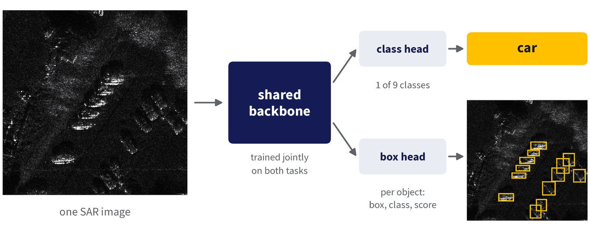

# Spending a 40 M Budget on Small Things: Multi-Task Learning on SAR Images

CS701 team project (Team 04). One model classifies a SAR image (9 classes) and detects its objects, within 130 M
parameters in total and 40 M trainable. This repository trains and runs the final model, **d16**: a frozen DINOv3
ViT-B/16 with DoRA and Convpass adapters, a P2 conv stem and a Faster R-CNN head with fused RoI pooling.



| | Codabench val | Codabench test |
|---|---:|---:|
| **Δm** (mean relative gain in macro-F1 and mAP over ViT-B/16 + LoRA) | **+44.50** | **+48.20** |

123.93 M parameters in total, 38.86 M trainable; trained 250 epochs (19.6 h) on one NVIDIA L40S.
Model and training: [docs/MODEL.md](docs/MODEL.md). Results and ablations: [docs/RESULTS.md](docs/RESULTS.md).

## Reproduce the results

Requirements: Python 3.13 (`python3.13`, or `py -3.13` on Windows) and, for training, an NVIDIA GPU with ~20 GB.
Each script creates `.venv/` from `requirements.txt` (the exact versions of the final run: torch 2.9.0, CUDA 12.8)
and downloads the [course data](https://huggingface.co/datasets/doem1997/cs701-sar-course-data) into `data/` the
first time it runs.

**1. The final model's val and test scores.** Put the submitted `model.pt` in `final_weights/`, then:

| macOS / Linux | Windows |
|---|---|
| `bash scripts/predict.sh` | `scripts\predict.bat` |

This writes `submission_val.zip` and `submission_test.zip` (`classification.csv` + `detection.json`, the Codabench
format) and scores them with `evaluate.py` against the val and test labels released after the leaderboard closed:
macro-F1, mAP and Δm, as Codabench computed them (scoring the original val submission this way gives its +44.50).
As in the submissions, val uses NMS IoU 0.8 and test 0.85. No Hugging Face login is needed: the DINOv3 architecture
is bundled and every weight comes from `model.pt`. On a GPU it takes ~25 min for both splits, mostly SAR-BM3D
pre-processing on the CPU (`--workers N` to change it); a CPU alone also works, more slowly. A second run reuses
`preprocess_cache/`.

**2. Training the final model from scratch.** The pretrained DINOv3 is gated: accept the licence on
[its model page](https://huggingface.co/facebook/dinov3-vitb16-pretrain-lvd1689m) and run `hf auth login` once
(after the first script run, from `.venv`). Then:

| macOS / Linux | Windows |
|---|---|
| `bash scripts/train.sh` | `scripts\train.bat` |

This trains on all of `data/train` with `configs/final.yaml` (seed 0, 250 epochs, ~19.6 h on an NVIDIA L40S) and
writes `runs/d16_final/{log.txt, metrics.json, model.pt}`. If it is interrupted, run it again: it resumes from
`runs/d16_final/last.pt`. To predict with the new model: `WEIGHTS=runs/d16_final/model.pt bash scripts/predict.sh`
(Windows: `set WEIGHTS=runs\d16_final\model.pt` first).

Extra arguments go to `train.py` / `predict.py`: `--epochs 1 --limit 64` for a quick check, `--val-fraction 0.1`
for a held-out validation every 4 epochs (as in the ablations), `--wandb` to log to Weights & Biases. On a SLURM
cluster, `scripts/train.sbatch` and `scripts/predict.sbatch` do the same (see their headers).

## Repository

```
train.py                 train the final model (configs/final.yaml)
predict.py               trained model + images.json -> Codabench submission zip
evaluate.py              submission zip + released labels -> macro-F1, mAP, Δm
configs/final.yaml       every training and inference setting of d16
sarbench/
├── config.py            load and check the YAML config
├── data.py              course data, held-out split, flips, same-class copy-paste, images-only split
├── preprocess.py        pseudo-RGB: amplitude, SAR-BM3D despeckling, Sobel edges
├── backbones.py         DINOv3 ViT-B/16 (+ dinov3_vitb16_config.json, its architecture)
├── adapters.py          DoRA and Convpass
├── model.py             input adapter, feature pyramid, P2 stem, RPN, fused RoIAlign; build_model
├── heads.py             RoI head with the GIoU loss term
├── metrics.py           macro-F1, COCO mAP (held-out validation)
├── checkpoint.py        last.pt for --resume
└── submission.py        the Codabench zip
final_weights/           put the submitted model.pt here
scripts/                 train / predict: .sh (macOS, Linux), .bat (Windows), .sbatch (SLURM)
tests/                   CPU tests: python -m pytest tests (~10 s, no data or GPU needed)
docs/                    MODEL.md, RESULTS.md, results/ (every W&B run as CSV), figures/
```

## Links

- Data: https://huggingface.co/datasets/doem1997/cs701-sar-course-data
- Leaderboard and rules: https://www.codabench.org/competitions/18271
- DINOv3: https://huggingface.co/facebook/dinov3-vitb16-pretrain-lvd1689m
