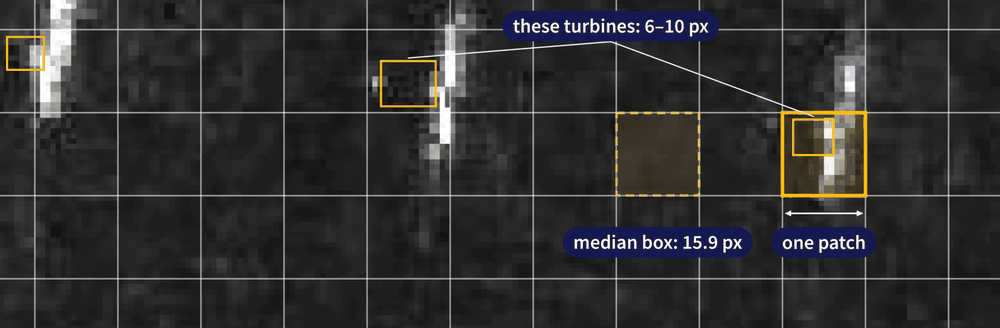

# Model and training

Back to the [README](../README.md). All settings are in [configs/final.yaml](../configs/final.yaml).



Half of the 32,533 train boxes are smaller than one 16 px ViT patch (median 15.9 px at 512 px), and 94.9 % of them
would be pooled from P2 alone under torchvision's RoI level mapping. Most components below exist for that.

## Architecture

```
gray SAR image -> resize 512 x 512 -> pseudo-RGB [amplitude, SAR-BM3D despeckled, Sobel edges]
  -> input adapter: ImageNet norm + 1x1 conv (identity init)
  -> DINOv3 ViT-B/16 (frozen; patch embedding unfrozen) with DoRA r32 on q/k/v/o + MLP up/down and a Convpass
     adapter (768 -> 256 -> 3x3 conv on the 32 x 32 token grid -> 768) after each of the 12 blocks
  -> 1,024 patch tokens x 768
       classification: mean token -> LayerNorm -> Linear(768, 9)
       detection:      ViTDet simple feature pyramid P2-P6 (256 ch); P2 += conv stem on the pixels (stride 4)
                       -> RPN (anchors 8-181 px, 3 ratios, 2,000 proposals) -> RoIAlign 7x7 on each of P2-P5,
                          fused by max -> 2 x fc 1024 -> 9 classes + boxes (smooth-L1 + GIoU)
```

| part | file | parameters (trainable) |
|---|---|---:|
| DINOv3 ViT-B/16 (`facebook/dinov3-vitb16-pretrain-lvd1689m`) | `sarbench/backbones.py` | 85.07 M frozen, 0.59 M patch embedding |
| DoRA r=32 (alpha 32), 72 projections | `sarbench/adapters.py` | 5.39 M |
| Convpass 256, 12 blocks | `sarbench/adapters.py` | 11.81 M |
| input adapter, simple feature pyramid, P2 stem, RPN, RoI head | `sarbench/model.py`, `heads.py` | 21.06 M |
| image classifier | `sarbench/model.py` | 0.01 M |
| **total** | | **123.93 M (38.86 M trainable)** |

Limits: 130 M total, 40 M trainable; `train.py` refuses to train over either.

- **Pseudo-RGB** (`sarbench/preprocess.py`). Channel 1 is the gray image with its brightest 0.5 % clipped, scaled to
  [0, 1]; channel 2 is SAR-BM3D (BM3D in the log domain, noise level estimated per image); channel 3 the Sobel
  magnitude of channel 2, each clipped and scaled the same way. Computed once per image and cached (`preprocess.cache`).
- **Input adapter.** DINOv3 was pretrained on ImageNet-normalized RGB; the 1x1 conv (identity at init) and the
  unfrozen patch embedding let the first layer adapt to the SAR channels.
- **DoRA** (Liu et al., 2024): `W' = m (W + (alpha/r) B A) / ||W + (alpha/r) B A||`, `m` initialized to `||W||`,
  B to 0: an exact no-op at init.
- **Convpass** (Jie & Deng, 2022): DoRA updates each token on its own; the 3x3 conv on the token grid adds local
  filtering for speckle and tiny objects. Zero-initialized output, so also a no-op at init.
- **P2 stem.** The ViT's P2 is a 4x upsampled stride-16 map. Two stride-2 3x3 convs (128, 256 channels), a 1x1 and a
  3x3 conv on the 512 px input add real stride-4 detail to it (0.96 M).
- **Fused RoI pooling.** Every RoI is pooled from all of P2-P5 and fused by element-wise max (PANet), so small boxes
  also read the ViT's own stride-16 features. No parameters.
- **Precision.** Backbone, neck and classifier run in bf16 autocast; the RPN and RoI head in fp32 (in bf16, box
  coordinates near 512 px would snap to a 2 px grid). TF32 is enabled for fp32 matmuls and convolutions.

## Training

- Data: all 9,392 images of the course train split (`val_fraction: 0`). Each image is resized to 512 x 512
  (non-square images are stretched; boxes are scaled with them and mapped back for the submission).
- Augmentation: random horizontal and vertical flips; with probability 0.5, up to 3 objects pasted from another
  image of the same class (1 px context margin, no overlap above IoU 0.3). No mosaic.
- Loss: 0.1 x image cross-entropy + RPN objectness + 1.5 x RPN box + RoI cross-entropy + 2.0 x (RoI smooth-L1 +
  GIoU).
- AdamW, weight decay 0.05, batch 16, 250 epochs (147k steps); 1 epoch linear warmup, then cosine decay to 0.
  Learning rates: DoRA + Convpass 3e-4, new detection modules 2e-4, image classifier 1e-4, patch embedding 2e-5.
- Seed 0. The model after the last epoch is the final model (no checkpoint selection).
- Compute: 19.6 h on one NVIDIA L40S, 19.7 GB peak GPU memory (plus ~1.5 s per image of SAR-BM3D in the first epoch,
  on the data-loader workers).

Bit-for-bit GPU reproduction is not guaranteed (cuDNN and atomic-add kernels are non-deterministic), but the code,
initialization, data order and augmentation draws are the ones of the original run: the cleanup of this repository
was checked to give identical initial weights, augmented samples, losses and detections on the CPU.

## Inference

`predict.py` builds the same network from `sarbench/dinov3_vitb16_config.json` (no Hugging Face download), loads
`model.pt`, and keeps up to 100 boxes per image above score 1e-5 after per-class NMS at IoU 0.85 (both tuned on the
held-out split; the val submission used 0.8, `--nms-thresh`). The image class is the classifier's argmax. Boxes are
mapped back to original pixels and written as `submission_<split>.zip` (`classification.csv` + `detection.json`);
`evaluate.py` scores a zip against the released labels.
